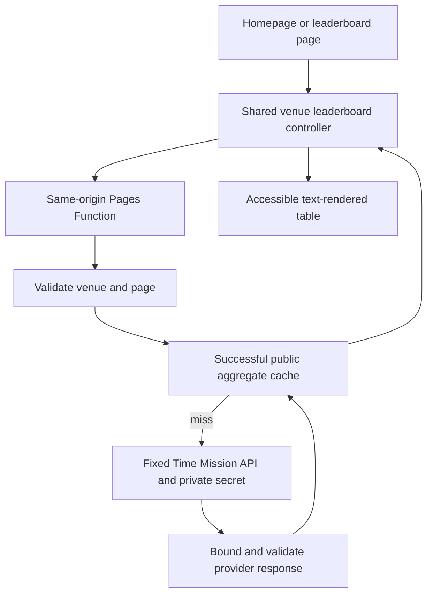
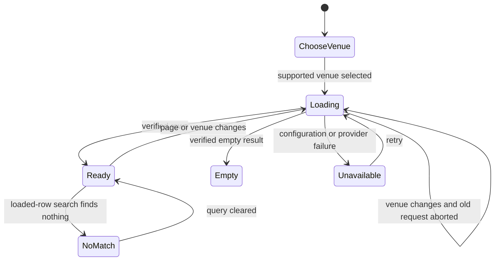

# Website v2 integration - Plan

## Goal Capsule

- Objective: Visitors can use Jefferson's refreshed Time Mission site, complete their existing booking journeys, and see truthful venue leaderboard results on desktop and mobile.
- Means: Reuse the complete `origin/website-v2` design and its newer site baseline, then repair contract regressions and replace the sample leaderboard through the existing Pages Function boundary (KTD1–KTD5).
- Authority: The approved scope and Product Contract govern behavior. The branch at `bbe2928` governs visual intent. Existing booking, consent, CMS, locale and public-route contracts remain binding.
- Execution profile: One locally verified integration change on a feature branch. Preserve the original checkout's dirty lockfile, ideation document and workbook. Use an isolated checkout if dependency updates would collide with that work.
- Finish: Implementation and local verification are authorized. Production deploys, live CMS migrations, DNS changes, API key rotation and sending messages are outside this delivery.
- Stop conditions: A destructive migration, unavailable private credential, or a provider contract that prevents a specific requested result is surfaced explicitly; the site must not substitute invented scores.

---

## Product Contract

### Summary

Incorporate the full v2 design, including the shared site shell and redesigned page families.
Keep the scoreboard layout, connect it to verified venue results, and express unavailable data honestly.
Validate security, accessibility, loading behavior and the existing commerce/content journeys before delivery.

### Problem Frame

The current checkout predates Jefferson's refresh and its newer architecture baseline.
The design branch contains a sample leaderboard whose periods, mission counts and combined venue ranks are not established by the real API.
Copying it unchanged would publish fabricated competition results and introduce regressions into existing booking and location behavior.

### Requirements

**Design and existing journeys**

- R1. Incorporate the complete visual refresh from `f7a5126` through `bbe2928`, including navigation, location selection, typography, homepage, footer, missions, locations, about, groups, press and FAQ surfaces.
- R2. Preserve current booking destinations, payment-return recovery, selected venue context, signup and closure CTA behavior, contact/newsletter submissions and group inquiry routes.
- R3. Preserve CMS content ownership, known routes, redirects, canonical/hreflang behavior, consent and non-PII analytics contracts across US and EU profiles.
- R4. Keep the location picker usable without geolocation; request it only after an explicit nearby-location action and do not persist raw coordinates.
- R5. Show venue-operating information using the existing authoritative hours/status contract; suppress an unverifiable open/closed claim rather than using the visitor's timezone.

**Leaderboard**

- R6. Both the homepage and `/leaderboard` show results for an explicitly identified supported venue; selection works when no stored location exists.
- R7. Show only actual team names and scores. Do not display sample teams, per-team mission counts, cross-venue ranks or unverified weekly/monthly/all-time claims.
- R8. Fetch paginated results without inventing ranks. Preserve provider order and label any displayed position as position in the venue's returned results; search describes its loaded-result scope.
- R9. Differentiate loading, genuinely empty results, no search matches, missing configuration, unsupported venue and temporary upstream failure, with a working retry action for failures.
- R10. Changing venue during an active request cannot render the old venue's result under the new venue label.
- R11. Provider authentication stays server-side. The public endpoint accepts only bounded documented inputs and cannot act as an arbitrary upstream proxy.

**Quality**

- R12. Keyboard navigation, focus management, screen-reader labels, mobile tap targets, reduced motion and text contrast remain usable throughout the refresh.
- R13. Avoid regressions in measured first-load bytes, rendering time and layout stability; record repeatable before/after measurements rather than claiming improvement from code inspection.

### Acceptance Examples

- AE1. Covers R6–R10. A first-time visitor selects Philadelphia and sees only the Philly API result; a rapid switch to Houston never lets Philly's late response overwrite Houston.
- AE2. Covers R7/R9. A provider HTTP 200 body containing `Access Forbidden` produces an unavailable state, not an empty table or zero score.
- AE3. Covers R2/R4. Opening the location picker does not invoke a browser location permission request. Selecting a venue keeps the current booking context and its specialized CTA label.
- AE4. Covers R3/R12. On a localized EU route, opening menus and changing venue preserves the selected language and consent defaults, with no keyboard trap.
- AE5. Covers R11. A request with an unsupported platform, excessive page, extra upstream URL or malicious team name cannot expose credentials, make arbitrary requests or inject markup.

### Success Criteria

All page families in R1 are inventoried and verified against the pinned design branch at desktop and mobile widths.
Required source checks, builds and representative smoke tests pass or have a specific evidenced environment blocker.
No demonstration leaderboard data or authentication key appears in the shipped public artifact.
Changes do not conceal failures by removing contract checks.

### Scope Boundaries

No new player accounts, achievement economy, individual score history or inferred skill ratings.
No migration of operational venue data to the score API; existing source ownership remains authoritative.
No generalized API gateway, continuous polling, new database, service worker or automatic geolocation system.
These mechanisms are unnecessary for the two verified read calls; reconsider only when a documented requirement needs them.
Live Instagram access remains optional: retain the designed static fallback unless its current provider contract and credentials can be verified.
Period-specific labels and richer scoreboard columns remain unavailable until the provider documents the corresponding semantics.

---

## Planning Contract

### Evidence and Assumptions

- Current checkout is `arisimon/scoreboard`, HEAD `c8f7b18`, with pre-existing edits to `package-lock.json` and untracked ideation/workbook outputs.
- `origin/website-v2` is `bbe2928`, built on `b7c11af` before the initial refresh commit `f7a5126`. This includes newer architecture and operational work; importing only its styling into the old checkout would miss those dependencies.
- Design-specific difference: approximately 165 files, 9,551 inserted lines and 925 removed lines. The larger branch-to-current diff also includes the newer baseline.
- `js/leaderboard.js` currently fetches `data/leaderboard.json`; it expects synthetic periods and a mission count not supplied by the real response.
- Previously verified API: `select_location_leaderboard`, channel `3003`, platform `1002`, numeric period `0`, string page `0`; response is nested under `1/select_location_leaderboard` with `total_records`, `entries[{team_name,total_game_score}]`, and `result_code:1`.
- Earlier verified mappings: Lincoln 1001, West Nyack 1002, Manassas 1004, Philadelphia 1005, Mount Prospect 1006, Houston 1008, Orland Park 1009, Edison 1011, Dallas 1012. Revalidate supported mappings during implementation; errors do not establish a venue is invalid.
- Numeric period `0` is a tested provider value, not evidence of a named time window. Use neutral `Venue scores` wording.
- A successful HTTP request with a Time Mission Origin header does not prove production credentials/configuration or browser integration. Keep the supplied key out of repository files and build output.
- Exact tests and provider availability are execution-time evidence, not assertions that checks already passed.

### Key Technical Decisions

- KTD1. Use the pinned v2 tree as the integration baseline, then layer focused repairs; retain its newer architecture rather than manually re-porting hundreds of prerequisites. Preserve unrelated working files through isolation when necessary. Governs R1–R3.
- KTD2. Add `functions/api/leaderboard.js` at the existing Pages Function seam with a focused shared helper and a static allowlist mapping canonical location slugs to supported IDs. Keep that shared mapping inside `functions/_shared/` so deployment staging includes it. A Pages secret supplies authentication. Use a fixed HTTPS origin, manual redirects rejected, explicit method/query validation, a deadline and bounded streaming body read, then validate the nested provider schema and result code. Never reflect raw upstream failures or credential-bearing URLs. Governs R6–R11.
- KTD3. Keep the provider's numeric period fixed at the verified value and expose no named time filter until documented. Use bounded page numbers and the observed ten-entry page behavior without computing unsupported global ranks. Do not aggregate all venues. (session-settled: user-approved — chosen over publishing the sample scoreboard's richer claims: real API fields do not substantiate them.) Governs R7/R8.
- KTD4. Cache only successful normalized public venue aggregate responses for a short explicit TTL keyed by venue and page; failures are not success-cached. Set content type, cache and security headers inside the Function because Pages static headers do not apply there. No persistent storage or stale-while-revalidate mechanism. Governs R9/R11/R13.
- KTD5. Reuse one leaderboard component/runtime for home and full page. Render text using DOM text APIs, abort superseded requests, and share equivalent in-flight requests. Subscribe to the existing `TM.onChange` location contract, including clear/restore, and carry an allowlisted venue query parameter from home to the full scoreboard because US global selection is not persisted across pages. Preserve the new visual treatment with native labeled controls and ordinary pagination. Governs R6–R12.
- KTD6. Repair changed navigation and utility logic at the shared source: retain passed booking CTA props, remove automatic location permission/persistence, and honor authoritative venue status/hour context. Validate return links rather than changing booking providers. Governs R2/R4/R5.
- KTD7. Measure the pinned v2 baseline before optimization. Scope page-only styles/scripts to their route, preserve image dimensions and responsive candidates, and avoid unnecessary preloads, repeated listeners and high-frequency layout reads. Keep Termina's design intent using its configured licensed web project and an immediate fallback; do not copy proprietary fonts from a third party. Governs R1/R12/R13.

### High-Level Technical Design

The diagrams describe boundaries and expected transitions; implementation names inside helpers may differ.

### System-Wide Impact and Risks

The new endpoint must appear in root `_routes.json`, the generated route list in `scripts/lib/static-pages-output.mjs`, route assertions in `scripts/check-csp-hashes.js`, deployment staging and Function bundle coverage.
The scoreboard page also participates in route data, SEO, localized output and CMS metadata migration already supplied by v2.
The migration must remain idempotent and must not run against production during local implementation.
Navigation touches booking, payment returns, closures and signup states, so a visual-only review is insufficient.
Static public caches may contain team display names only as already returned by the venue leaderboard; no player lookup or new personal information is requested.

---

## Implementation Units

### U1. Integrate the pinned branch and capture the baseline

- **Goal:** Make every v2 design surface available on a safe local integration branch.
- **Requirements:** R1–R3, R13.
- **Dependencies:** None.
- **Files:** The full pinned source tree, especially `src/components/`, `src/pages/`, `src/partials/`, `css/`, `js/`, `assets/`, `cms/migrations/`, route data and build scripts; existing `tests/smoke/visual.spec.js` and `tests/smoke/mobile-layout.spec.js`.
- **Approach:** Follow KTD1. Record the pre-work dirty snapshot and the design change inventory. Install the pinned dependencies in the integration checkout and measure representative v2 pages before focused repairs.
- **Test scenarios:** Existing route, booking and consent checks establish the inherited baseline. Compare home, one venue, locations, missions, groups, FAQ, about and press at mobile and desktop widths. Record baseline failures without normalizing them away.
- **Verification:** The branch contains the full design revision and no unrelated WIP was modified or included.

### U2. Add the secure venue leaderboard boundary

- **Goal:** Return a normalized truthful venue leaderboard through a same-origin endpoint.
- **Requirements:** R6–R11, AE2/AE5.
- **Dependencies:** U1.
- **Files:** New `functions/api/leaderboard.js`, `functions/_shared/leaderboard.mjs`, venue mapping in `functions/_shared/leaderboard-locations.json`, `.env.example`, `docs/tm-public-api.md`, `_routes.json`, `scripts/lib/static-pages-output.mjs`, `scripts/check-csp-hashes.js`, deployment bundle/staging checks; new `tests/leaderboard-api.test.mjs` and existing `tests/cloudflare-functions-bundle.test.mjs`.
- **Approach:** Implement KTD2–KTD4 at the existing Pages Function seam. No new dependency is needed. Refresh the earlier venue evidence using the known read-only call; store no credential in fixtures or sources.
- **Execution note:** Establish a failing request/response contract test before implementing the endpoint.
- **Test scenarios:** Valid venue/page returns exact normalized fields; malformed or unknown queries return a bounded client error; missing secret is unavailable; timeout, redirect, oversized body, HTTP failure, HTTP-200 text error, invalid nested schema and non-success code fail closed; markup in team names stays plain data; cached successful pages remain venue-specific; generated deployment output routes to the actual Function.
- **Verification:** Tests exercise the real handler with controlled upstream responses. They prove validation and transport behavior, not production provider availability; a separate redacted live request supplies that evidence.

### U3. Connect both scoreboard surfaces

- **Goal:** Replace sample scores with a venue-aware accessible experience.
- **Requirements:** R6–R12, AE1/AE2/AE5.
- **Dependencies:** U2.
- **Files:** `src/components/Leaderboard.astro`, `src/pages/leaderboard.astro`, `src/pages/index.astro`, `js/leaderboard.js`, `css/leaderboard.css`, `data/leaderboard.json`, locale and SEO catalogs; new `tests/smoke/leaderboard.spec.js` and `tests/leaderboard-contract.test.mjs`.
- **Approach:** Implement KTD3/KTD5. Remove demonstration data from public assets, replace unsupported period/mission claims consistently, preserve the intended table/filter styling, and make first-visit venue selection explicit on both surfaces.
- **Test scenarios:** Default and unsupported venue, populated and empty responses, no search match, retry after upstream failure, next/previous page boundaries, literal HTML-looking team names, keyboard control labels, locale changes, home/full-page reuse, and out-of-order responses after rapid venue switching. Search states that it searches loaded results.
- **Verification:** A real local Function response reaches the browser; fixture-based browser tests cover errors and race ordering. No sample names or secrets remain in generated public output.

### U4. Preserve booking and location contracts in the new shell

- **Goal:** Repair behavior regressions while retaining the v2 navigation/picker layouts.
- **Requirements:** R2–R5, R12, AE3/AE4.
- **Dependencies:** U1.
- **Files:** `src/components/SiteNav.astro`, `src/components/MobileMenu.astro`, `src/components/LocationOverlay.astro`, `js/nav.js`, location-hours runtime owner discovered from its callers, `_headers.tmpl`, translations; existing `tests/browser-navigation-contracts.test.mjs`, `tests/browser-booking-contracts.test.mjs`, `tests/smoke/mobile-layout.spec.js`, `tests/smoke/briq.spec.js`, `tests/smoke/site-booking.spec.js`.
- **Approach:** Follow KTD6. Preserve booking props and labels, attach geolocation to an explicit action, discard precise coordinates after sorting, and avoid auto-changing the selected venue. Defer to the existing location status/hour contract or show configured hours without an invented open-now assertion.
- **Test scenarios:** Standard bookable, coming-soon signup and temporary closure contexts; opening picker without permission request; explicit nearby action accepted/denied/unavailable; prior selection preserved; keyboard focus returns after closing; EU locale retained; Briq payment-return behavior continues; device and venue timezone mismatch does not produce false hours.
- **Verification:** Shared runtime and browser contract tests pass; source and responsive review confirm the design treatment remains.

### U5. Bound resources and verify the integrated design

- **Goal:** Deliver measured performance and compatibility evidence for the complete integration.
- **Requirements:** R1–R3/R12/R13.
- **Dependencies:** U3/U4.
- **Files:** `src/data/site/site-css-assets.json`, `src/components/SiteHead.astro`, `src/components/PageWidgetsScripts.astro`, affected page head links, new v2 CSS, image markup, `functions/api/social-feed.js`, `js/social-feed.js`, existing `scripts/check-mobile-performance-contract.js`, `scripts/check-best-practices.js`, `tests/smoke/visual.spec.js`, `tests/smoke/csp.spec.js`, `tests/smoke/eu-profile.spec.js`; add focused social-feed handler coverage if its behavior changes.
- **Approach:** Apply KTD7 only where measurements or a concrete regression justify changes. Preserve assertions whose prior target no longer exists by updating their contract to the new behavior, never by deleting the protection. Keep optional social content on the static fallback without a provider token. For enabled social fetches, preserve fixed upstream, timeout/body bounds and safe HTTPS output.
- **Test scenarios:** Route-specific CSS absent from unrelated pages, matching LCP preload and dimensions, readable fallback fonts, no unsolicited geolocation, no unexpected console/CSP errors, reduced-motion behavior, narrow-screen table/menu/picker layout, working static social fallback, and cached API requests not repeated on each keystroke.
- **Verification:** Source checks and US/EU builds complete; representative mobile/desktop smoke and accessibility tests pass. Compare repeated measurements under identical settings against U1, report resource totals and LCP/CLS/TBT with actual limitations. Review all v2 page families against the pinned source and explain intentional changes.

---

## Verification Contract

| Gate | Evidence |
|---|---|
| Source contracts | `npm run check` on the integration tree; isolate inherited failures from new ones. |
| Endpoint | Node/Vitest handler tests at the existing project seams; live provider smoke uses private environment input and redacts URL/body identifiers. |
| Artifact | `npm run build:us`, `npm run build:eu`, then relevant artifact checks after each matching build. Check generated `_routes.json` and Function packaging. |
| Browser | `npm run test:smoke` with focused leaderboard, navigation, booking, locale, CSP and mobile coverage against a local server on `127.0.0.1`. Actual Function integration must use the Pages runtime, not Astro's static preview alone. |
| Visual | Home, locations, mission grid, venue, about, group overview/detail, press and FAQ; desktop/mobile, picker/menu open states, and reduced motion. |
| Performance | Repeat Lighthouse or equivalent controlled measurements for home/venue/leaderboard before and after; record compressed JS/CSS, above-fold images, fonts and third-party bytes. Investigate budget excess rather than claiming a score from static inspection. |
| Security | No key in sources/generated bundles/logs, no unsafe team-name insertion, bounded upstream transport, fail-closed parsing, no broad new CSP relaxation, and dependency audit limited to the integrated graph. |

Performance skill budgets are investigation thresholds: page under 1.5 MB, compressed JS under 300 KB, CSS under 100 KB, above-fold images under 500 KB, fonts under 100 KB, third-party under 200 KB. Preserve the requested design and explain any measured exception.

---

## Definition of Done

- The full pinned v2 design and newer prerequisite baseline are present locally.
- U2–U4 behavior is verified at its real public seams and generated routing is correct.
- The scoreboard uses supported venue data or an explicit unavailable state, with no fabricated periods, counts or global comparisons.
- U5 measurements and visual checks are recorded, and failed required gates are fixed or reported as concrete blockers.
- The original dirty checkout work remains preserved and the integration checkout/branch is identified in the handoff.
- Implementation remains local; no production data, release, DNS or credential configuration was changed.

---

## Sources and Research

- `origin/website-v2@bbe2928`; design baseline `b7c11af`; `RTK.md`, `CONTEXT.md`, `.impeccable.md`.
- `src/components/Leaderboard.astro`, `js/leaderboard.js`, `data/leaderboard.json`, `src/components/SiteNav.astro`, `js/nav.js`, `scripts/lib/static-pages-output.mjs`, `scripts/check-csp-hashes.js`.
- Earlier read-only Time Mission API evidence in this conversation; fresh execution-time validation is required because the credential and provider state may change.
- [Cloudflare Pages Function headers](https://developers.cloudflare.com/pages/configuration/headers/): KTD4 sets headers inside Functions.
- [Cloudflare Cache API](https://developers.cloudflare.com/workers/runtime-apis/cache/): KTD4 uses explicit successful-response caching without assuming stale-while-revalidate.
- [Cloudflare Workers Request](https://developers.cloudflare.com/workers/runtime-apis/request/): KTD2 rejects redirects at the fixed upstream boundary.
- User-named best-practices and performance skills govern the security, compatibility and measurement work without introducing unrelated framework or dependency changes.
